<div align="center">

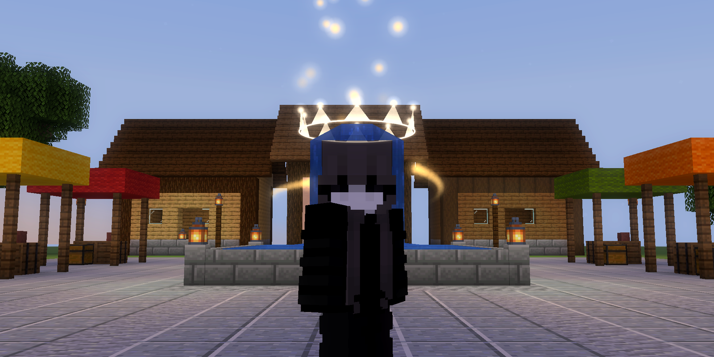

# Angelic Halo

**A cosmetic ring of light around your player — for Minecraft 26.2 on Fabric.**

Scanning sweeps, fading trails, glowing halos, sonar pings, crowns, galaxies and a full colour studio —<br>
all drawn locally on your screen. Nothing is sent to the server.


</div>

---

## Contents

- [Highlights](#highlights)
- [Install](#install)
- [Controls](#controls)
- [Ring styles](#ring-styles)
- [Motion effects](#motion-effects)
- [The scan trail](#the-scan-trail)
- [Colour studio](#colour-studio)
- [Extras](#extras)
- [Presets](#presets)
- [Settings screen](#settings-screen)
- [Server safety](#server-safety)
- [How it is drawn](#how-it-is-drawn)
- [Building from source](#building-from-source)

## Highlights

<table>
<tr>
<td width="50%">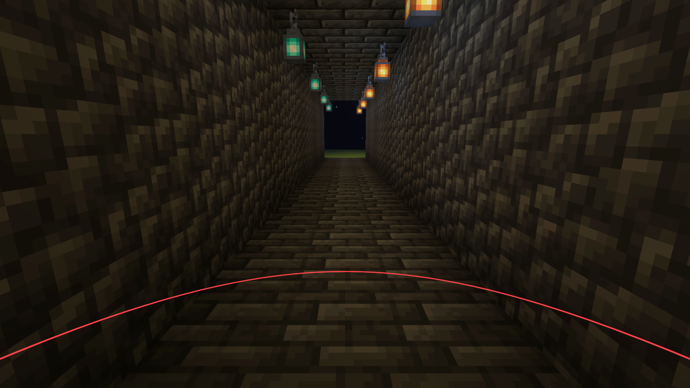</td>
<td width="50%">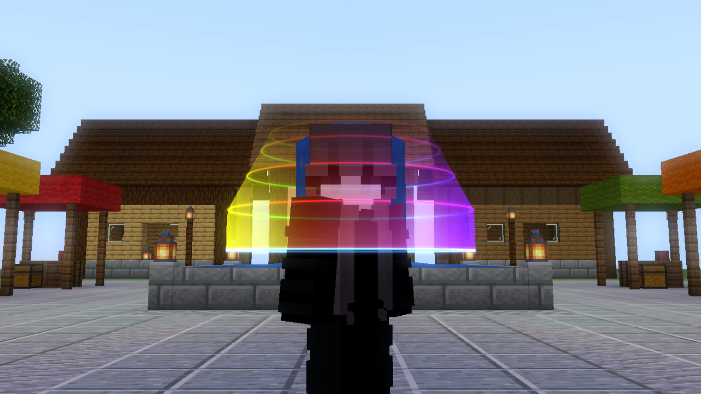</td>
</tr>
<tr>
<td align="center"><b>Classic</b> — the thin soft-red ring, 3 blocks out, at your feet. The default.</td>
<td align="center"><b>Scan + trail</b> — sweeps feet → head, leaving a fading, recolourable smear.</td>
</tr>
</table>

- **10 ring styles**, **8 motions**, **11 colour effects**: over 800 combinations before you touch a slider.
- **Scan trail** with its own colour studio, so the trail and the ring can look different.
- **Live "selfie" preview**: the camera swings round to face you while the menu is open, so you see every change as you make it.
- **Share codes**: copy your whole look to the clipboard and paste a friend's.
- **Constant-width lines**: thickness is set in screen pixels, so the ring stays crisp near and far, like the reference.
- **Depth-aware**: draws through blocks like the reference, or lets your body and walls partly hide the far side so effects look 3D. You choose the opacity.
- **Never reacts to hurt or death** unless you opt in. The ring is anchored in the world, not on the player model.

## Install

1. Install **[Fabric Loader](https://fabricmc.net/use/) 0.20.1+** for **Minecraft 26.2**.
2. Put these in your `mods` folder:
   | Mod | Required? | Where to get it |
   |---|---|---|
   | **Angelic Halo** | yes | [Releases](../../releases) or `build/libs/angelic-halo-<version>.jar` |
   | **Fabric API** `0.161.0+26.2` or newer | yes | [Modrinth](https://modrinth.com/mod/fabric-api) |
   | **Mod Menu** `20.0.x` | optional — adds a *Config* button in the mod list | [Modrinth](https://modrinth.com/mod/modmenu) |
3. Launch. Press **H** in game.

> **Tip:** test new mods in a *copy* of your instance first. In Prism/MultiMC, right-click → *Copy Instance*; in the Modrinth App, *Duplicate*.

## Controls

| Action | Default | Notes |
|---|---|---|
| Open settings | **H** | Rebind under *Options → Controls → Angelic Halo* |
| Toggle halo | *unbound* | Shows a short message above the hotbar |
| Next preset | *unbound* | Cycles through the presets |
| `/angelichalo` | — | Opens settings. Also: `toggle`, `reload`, `preset <name>` (with tab-completion) |

`/angelichalo` is a **client command**: Fabric handles it on your machine and never sends it to the server.

## Ring styles

| | Style | What it looks like |
|---|---|---|
| 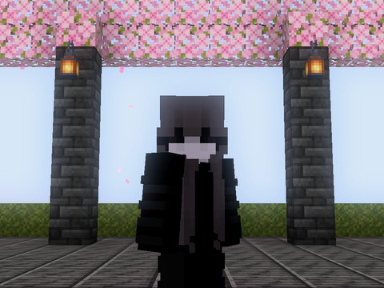 | **Line** | A crisp line of constant on-screen width. The reference look. |
| 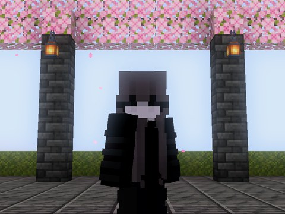 | **Glow Line** | The line plus an additive bloom whose width and strength you set. |
| 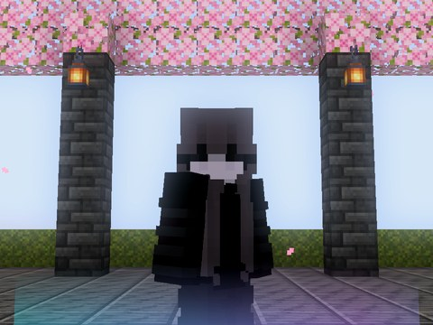 | **Aura** | A vertical curtain of light rising from the ring and fading out. |
| 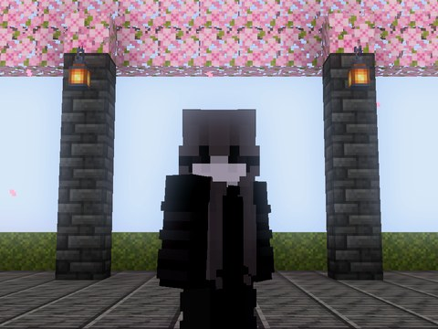 | **Disc** | A filled disc, faint in the centre, bright at the rim. |
|  | **Dashed** | Dashes with adjustable count and length; great with spin. |
|  | **Orbs** | Soft glowing spheres spaced around the circle. |
| 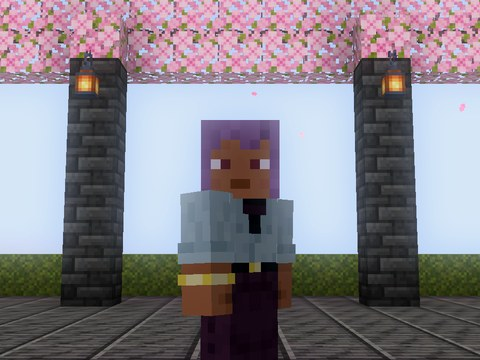 | **Sonar** | A radar disc with a bright rotating sweep beam. |
| 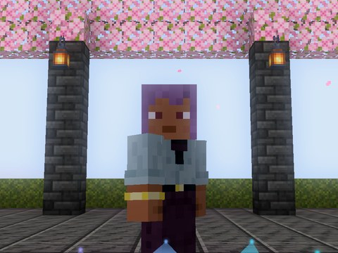 | **Crown** | Shimmering spikes of light standing on the ring, glowing at the tips. |
|  | **Galaxy** | Spiral arms of stars swirling around you. |
|  | **Lightning** | A crackling, jittering electric ring with sparks. |

Shape options: radius (0.2–16 blocks), line width, height, smoothness, spin, tilt, stacked ring count and spacing. Each style also has its own settings.

## Motion effects

| Motion | Description | Settings |
|---|---|---|
| **Static** | Stays at the chosen height. | — |
| **Scan** | Sweeps from feet to head and back. | speed, easing (sine / linear / smooth / bounce / elastic), direction (up & down / up / down), pause at ends, lowest/highest point, body contour |
| **Breathe** | Radius gently grows and shrinks. | amount, speed |
| **Halo** | A small ring floating above your head, bobbing. | radius, height, bob |
| **Ripple** | Rings spawn at your feet and spread out like sonar. | speed, count |
| **Wave** | The ring undulates in a travelling wave. | height, crest count, speed |
| **Gyro** | The ring wobbles like a spinning gyroscope. | angle, speed |
| **Heartbeat** | A double "lub-dub" pulse at a BPM you choose. | heart rate, amount |

## The scan trail

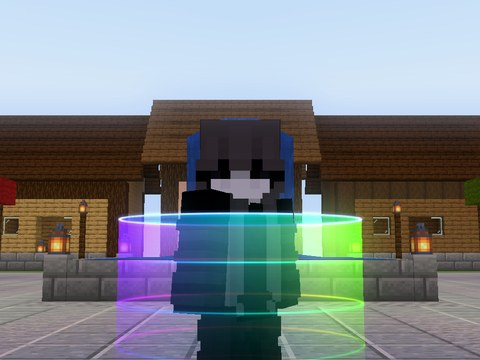 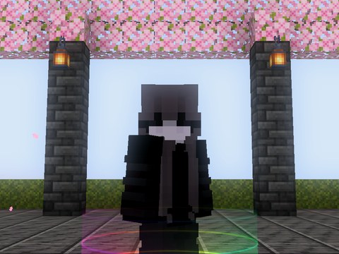 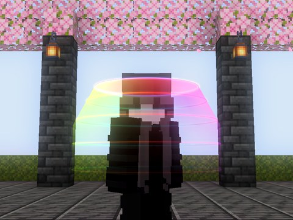 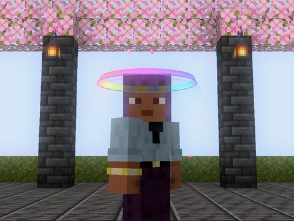

When the ring is scanning, a fading trail follows it up and down your body.

- **Smear**: a smooth gradient curtain between where the ring is now and where it just was.
- **Echoes**: fading copies of the ring along its recent path.
- **Smear + Echoes**: both.
- **Length** (how far back in time it reaches) and **echo count** are adjustable.
- The trail has **its own colour studio** (every effect below works on it), or you can tick *Match Ring Colours*.

## Colour studio

The ring, the trail and the extras each get their own copy of these settings:

| Effect | Description |
|---|---|
| **Solid** | One colour. |
| **Gradient** | Primary → secondary around the ring, seamless, scrolling. |
| **Rainbow** | Full hue wheel around the ring, scrolling. |
| **Chroma** | The whole ring cycles through hues together. |
| **Pulse** | Fades between primary and secondary. |
| **Height** | Primary at your feet, secondary at your head. Follows the scan. |
| **Comet** | A bright head with an exponential tail chasing around the ring. |
| **Health** | Green when healthy, red when hurt. Reads only your own health bar. |
| **Sparkle** | Random twinkling between the two colours. |
| **Aurora** | Drifting northern-lights bands of primary, secondary and a hue-shifted third colour. |
| **Fire** | Flickering flame noise. |

Pickers: hex input, a draggable **hue bar**, a 16-colour palette (left-click = primary, right-click = secondary), *swap*, *randomise*, plus opacity, effect speed, repeats, saturation and brightness. An animated strip previews the result.

## Extras

| Extra | Description |
|---|---|
| **Embers** | Glowing motes drift up off the ring and fade. Count, rise speed and size are adjustable. |
| **Helix** | 1–6 orbs spiral around your body with comet tails. |
| **Jump rings** | A ring bursts outward on the ground when you jump or land, anchored where it happened. |
| **Speed reactive** | The ring widens and brightens as you move faster. |
| **Damage flash** *(off by default)* | A flash and shockwave when you take damage, in any colour. |

## Presets

<table>
<tr>
<td align="center"><br><b>Classic</b></td>
<td align="center">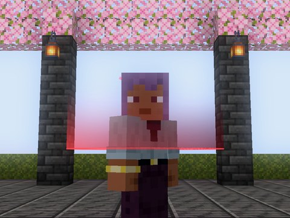<br><b>Classic Scan</b></td>
<td align="center">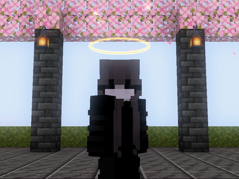<br><b>Angelic</b></td>
<td align="center">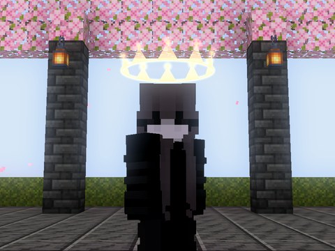<br><b>Seraph</b></td>
</tr>
<tr>
<td align="center">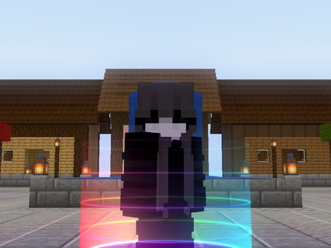<br><b>Scanner</b></td>
<td align="center">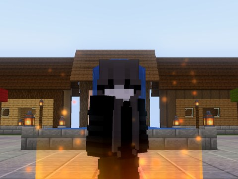<br><b>Inferno</b></td>
<td align="center">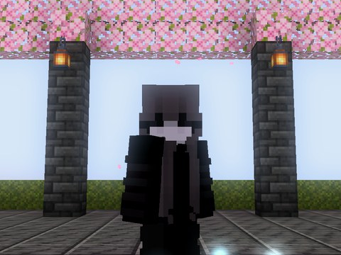<br><b>Frost</b></td>
<td align="center">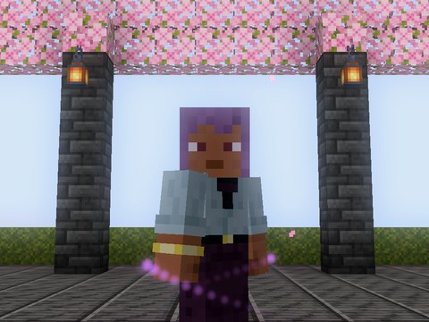<br><b>Void</b></td>
</tr>
<tr>
<td align="center">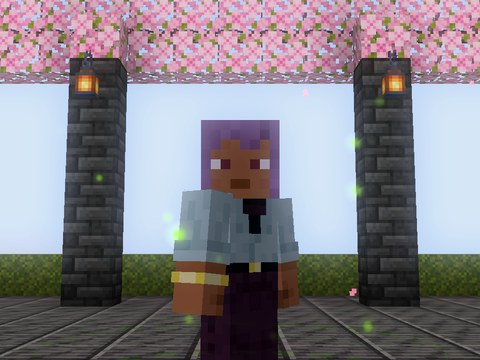<br><b>Toxic</b></td>
<td align="center">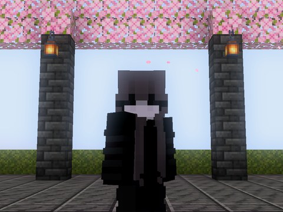<br><b>Sakura</b></td>
<td align="center">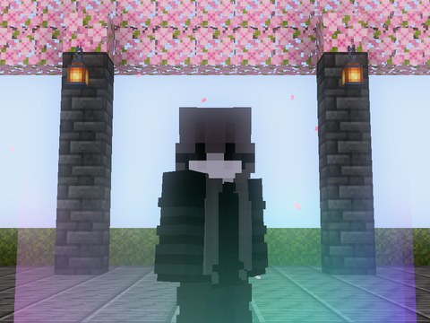<br><b>Aurora</b></td>
<td align="center">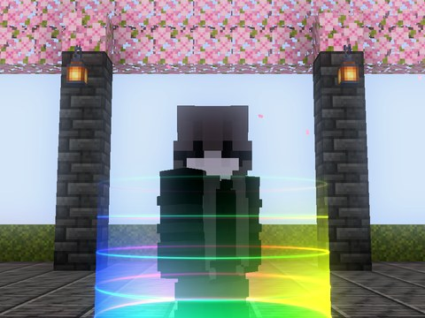<br><b>Rainbow Scan</b></td>
</tr>
<tr>
<td align="center">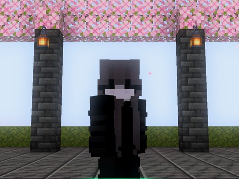<br><b>Radar</b></td>
<td align="center"><br><b>Storm</b></td>
<td align="center"><br><b>Galaxy</b></td>
</tr>
</table>

**15 presets.** They keep your visibility settings (first/third person, through blocks and so on) and replace the look.

## Settings screen

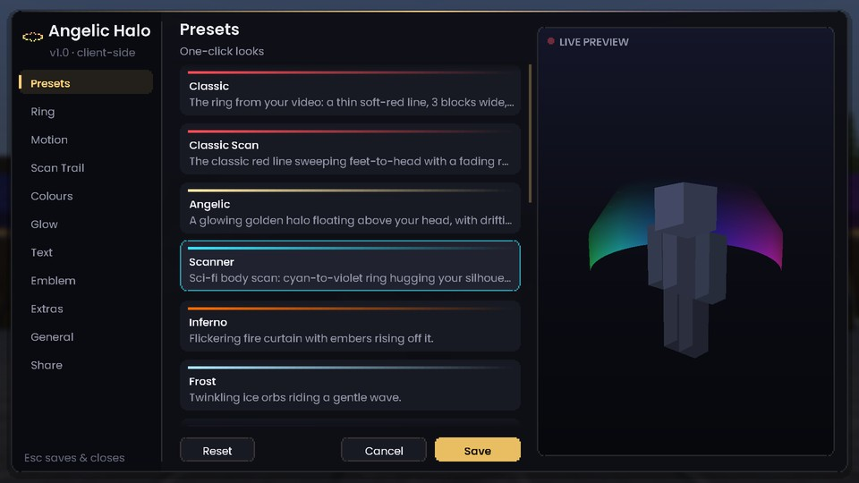 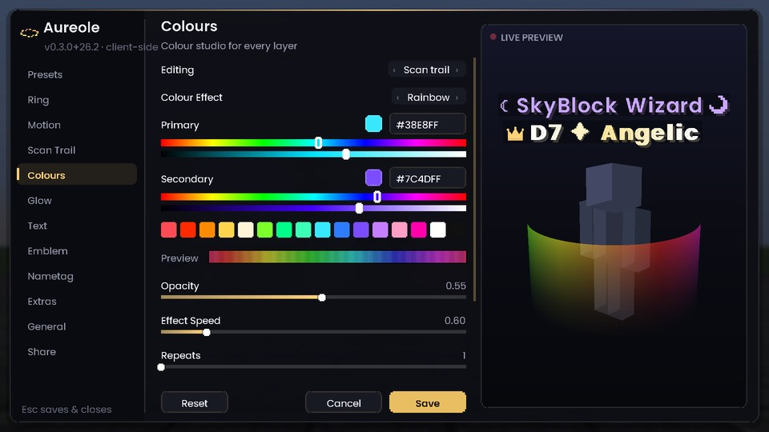

Seven tabs: **Presets · Shape · Motion · Scan Trail · Colours · Extras · General**. The panel sits on the left, so your character stays visible on the right. Every option has a tooltip. Changes apply live. **Done** (or Esc) saves, **Cancel** reverts and **Reset All** restores the classic look.

## Server safety

Angelic Halo is built to be safe on servers like Hypixel:

- **Client-only.** It declares `"environment": "client"` and does nothing on a server.
- **No networking.** It registers no packets or channels and never sends chat or commands. `/angelichalo` is a local Fabric client command.
- **No game changes.** No mixins at all. It only adds draw calls to the frame through Fabric's public rendering events, and reads your own position, ground state and health bar for the reactive extras.
- **Read-only world access.** It never touches blocks, entities, inventory or movement.

It is a cosmetic, like a resource pack, that only you can see. As always, the server's own rules are the final word on which mods are allowed.

## How it is drawn

- Geometry is built every frame in camera-relative space and submitted through Fabric's `LevelRenderEvents.COLLECT_SUBMITS` as custom geometry.
- Lines are **camera-facing ribbons**. Each vertex is pushed sideways by `width × distance × 2 / (projection.m11 × 1080)`, so a 2 px line is 2 px at any distance and FOV.
- Four tiny render pipelines derive from vanilla's position-colour debug pipeline: *translucent* and *additive* (bloom), each with and without depth testing ("through blocks"). They use vanilla shaders, so they work on both the **OpenGL and Vulkan** backends.
- Animation uses real time, so it stays smooth while the game is paused or lagging.
- All maths (motions, colours, geometry) is plain Java with no Minecraft types, and is unit-tested across every style × motion × colour combination.

## Building from source

Requires JDK 25.

```bash
./gradlew build                 # jar → build/libs/, also runs the unit tests
./gradlew runClient             # dev client
./gradlew runClientGameTest     # boots a real client, renders every preset and menu tab, saves screenshots
```

Every push runs CI: build, unit tests, then an in-game test in a throwaway singleplayer world that captures the screenshots used in this README.

<sub>Not affiliated with Mojang, Microsoft or Hypixel. Minecraft is a trademark of Mojang AB.</sub>
