<div align="center">


# Angelic Halo

**A ring of light that follows you — purely cosmetic, entirely client-side.**

Sweeping scans with fading trails, crowns of light, orbiting text and projected emblems,<br>
each with its own colour studio, all tuned live in an animated menu with a 3D preview.<br>
Built for Minecraft 26.2 on Fabric. Nothing is sent to the server; only you see it.


</div>

---

<table>
<tr>
<td width="50%"></td>
<td width="50%"></td>
</tr>
<tr>
<td align="center"><b>Classic</b>: the thin soft-red ring at your feet, drawn through walls, just like the reference clip. The default look.</td>
<td align="center"><b>Scan + trail</b>: sweeps feet to head and leaves a fading trail you can colour separately.</td>
</tr>
<tr>
<td width="50%">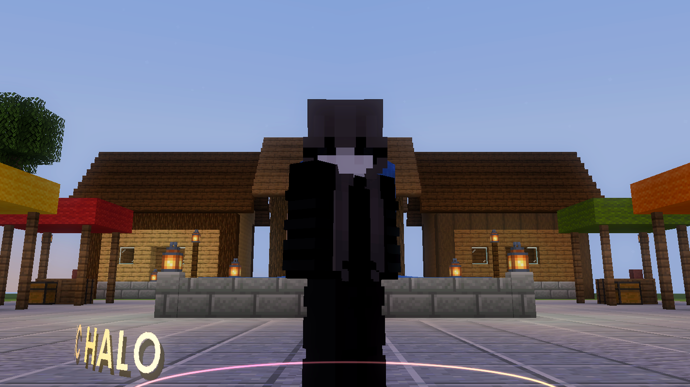</td>
<td width="50%">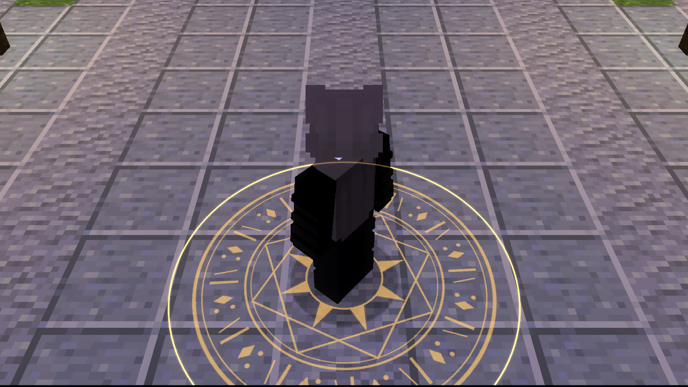</td>
</tr>
<tr>
<td align="center"><b>Your text</b>: orbiting band, engraved in the floor, or a banner over your head.</td>
<td align="center"><b>Your images</b>: built-in emblems, or any PNG you drop in a folder.</td>
</tr>
</table>

## Contents

- [Highlights](#highlights)
- [Install](#install)
- [Opening the menu](#opening-the-menu)
- [The menu](#the-menu)
- [Ring styles](#ring-styles) · [Motion](#motion) · [Scan trail](#scan-trail) · [Colour studio](#colour-studio)
- [Glow](#glow) · [Custom text](#custom-text) · [Emblems & your own images](#emblems--your-own-images) · [Extras](#extras)
- [Presets](#presets) · [Sharing & saved looks](#sharing--saved-looks)
- [Compatibility](#compatibility) · [Shaders](#shaders) · [Server safety](#server-safety)
- [How it's drawn](#how-its-drawn)
- [Building from source](#building-from-source)

## Highlights

- **10 ring styles × 8 motions × 11 colour effects.** Every layer (ring, trail, text, emblem, extras) has its own colour studio.
- **Scan trail** that follows the sweep as a smooth fading smear, echo rings, or both.
- **Custom text and images.** Write anything around you or project any PNG under, above or behind you.
- **Custom menu**: a fully hand-drawn, animated UI with a **live 3D projector** that renders your exact settings on a mannequin as you drag sliders.
- **Esc-menu shortcut**: a small animated halo button sits right next to *Friends*.
- **Bloom on everything**: a soft additive glow for the ring, trail, text, emblem and particles, with its own strength per layer.
- **Shader-proof**: tested with nine popular shaderpacks; colours stay intact (details below).
- **Refined rendering**: constant-width anti-aliased lines, soft radial orbs, depth-aware "through blocks".
- **Share codes and a saved-looks library**, in their own tab.
- **Never reacts to hurt or death** unless you opt in. The ring is anchored in the world, not on your player model.

## Install

1. Install **[Fabric Loader](https://fabricmc.net/use/) 0.20.1+** for **Minecraft 26.2**.
2. Put these in your `mods` folder:

   | Mod | Required? | Where |
   |---|---|---|
   | **Angelic Halo** | yes | [Releases](https://github.com/sn7d/angelic-halo/releases), or build it (see below) |
   | **Fabric API** `0.161.0+26.2` or newer | yes | [Modrinth](https://modrinth.com/mod/fabric-api) |
   | **Mod Menu** `20.0.x` | optional (adds a *Config* button to the mod list) | [Modrinth](https://modrinth.com/mod/modmenu) |

3. Launch and press **H**.

> **Tip:** try new mods in a *copy* of your instance first. In Prism/MultiMC right-click → *Copy Instance*; in the Modrinth App use *Duplicate*.

## Opening the menu

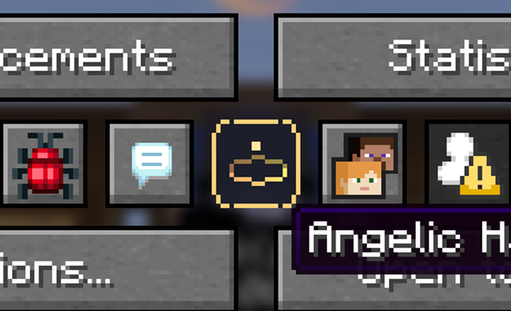

| Way | |
|---|---|
| **H** | rebind under *Options → Controls → Angelic Halo* |
| **Esc menu** | the halo button next to *Friends* |
| **`/angelichalo`** | also `toggle`, `reload`, `preset <name>` (tab-completes) |
| **Mod Menu** | *Config* button, if installed |

Optional keys, unbound by default: **Toggle halo** and **Next preset**.

`/angelichalo` is a Fabric **client command**: it runs on your machine and is never sent to the server.

<br clear="right">

## The menu

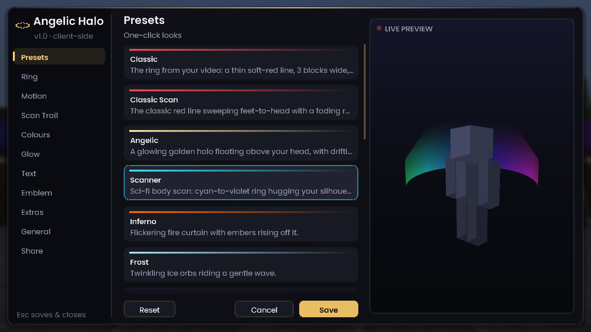

A dark glass window drawn entirely by the mod in the **Poppins** typeface (no vanilla buttons):

- **Sidebar** with a sliding selection indicator: *Presets · Ring · Motion · Scan Trail · Colours · Glow · Text · Emblem · Extras · General · Share*.
- **Animated controls**: sliders, switches, selectors and colour pickers that respond smoothly as you use them.
- **Smooth motion**: the window eases in, tabs cross-fade and slide, lists scroll with inertia, and tooltips fade in after a moment.
- **Live 3D projector** on the right: the same geometry code as in-game, rendered around a mannequin with perspective and depth sorting. It turns slowly on its own; **drag to orbit**, **scroll to zoom**.
- **Save**, **Cancel** (restores what you had) or **Reset** (back to the classic look). **Esc** saves.

<table>
<tr>
<td>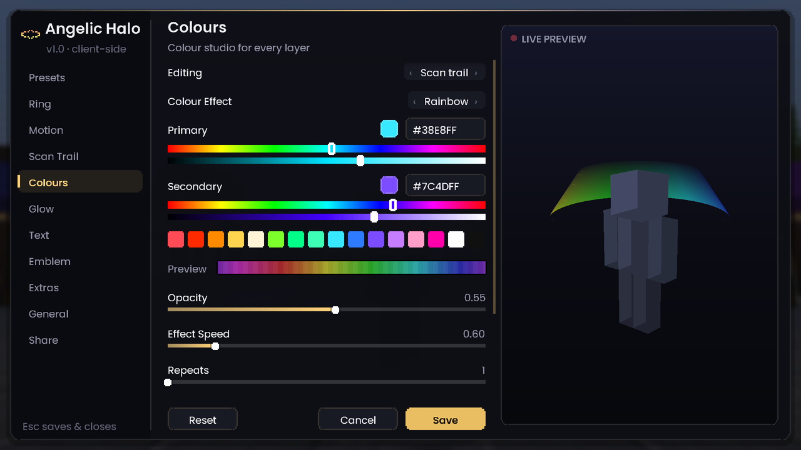</td>
<td>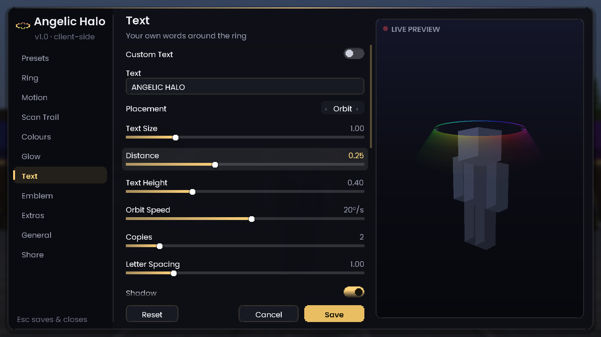</td>
</tr>
</table>

## Ring styles

| | Style | |
|---|---|---|
|  | **Line** | Crisp, anti-aliased, constant on-screen width. The reference look. |
|  | **Glow Line** | The line plus a two-layer bloom (width and strength adjustable). |
|  | **Aura** | A curtain of light rising off the ring and fading upwards. |
|  | **Disc** | A filled disc, faint in the centre, bright at the rim. |
|  | **Dashed** | Adjustable dash count and length; pairs well with spin. |
|  | **Orbs** | Soft glowing spheres with a smooth radial falloff. |
|  | **Sonar** | A radar disc with a rotating sweep beam. |
|  | **Crown** | Shimmering spikes of light with glowing tips. |
|  | **Galaxy** | Spiral arms of stars turning at your feet. |
|  | **Lightning** | A crackling electric ring with sparks. |

You can reshape any style (its size, thickness, height, spin and tilt) and stack several rings. Each style also has a few settings of its own.

## Motion

| Motion | What it does |
|---|---|
| **Static** | Stays where you put it. |
| **Scan** | Sweeps between your feet and head, with adjustable speed, rhythm and range. |
| **Breathe** | Gently grows and shrinks. |
| **Halo** | A small ring floats above your head. |
| **Ripple** | Rings spread out from your feet like sonar pings. |
| **Wave** | The ring undulates in a travelling wave. |
| **Gyro** | Wobbles like a spinning gyroscope. |
| **Heartbeat** | A double "lub-dub" pulse. |

Every motion has its own settings for pace and size.

## Scan trail

   

While the ring scans, a trail follows its path and fades away behind it, either as a smooth smear, as echo copies of the ring, or both. You choose how long it lingers, and it has **its own colours**, so the trail can look completely different from the ring.

## Colour studio

| Effect | |
|---|---|
| **Solid** | One colour. |
| **Gradient** | Primary → secondary around the ring, seamless and scrolling. |
| **Rainbow** | The full hue wheel around the ring, scrolling. |
| **Chroma** | The whole layer cycles through hues together. |
| **Pulse** | Breathes between primary and secondary. |
| **Height** | Primary at your feet, secondary at your head. Follows the scan. |
| **Comet** | A bright head with a tail chasing around the ring. |
| **Health** | Green when healthy, red when hurt. Reads only your own health bar. |
| **Sparkle** | Random twinkling between the two colours. |
| **Aurora** | Drifting northern-lights bands with a hue-shifted third colour. |
| **Fire** | Flickering flame noise. |

Pick colours by hex code, hue and shade sliders or a quick palette, then tune opacity, speed and intensity while a live strip previews the result.

## Custom text

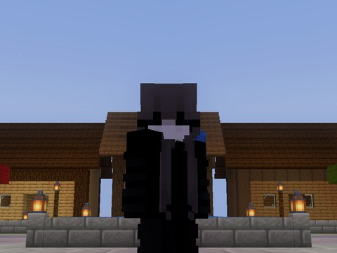 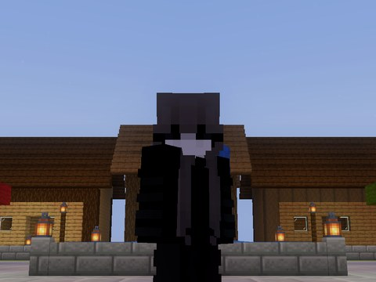 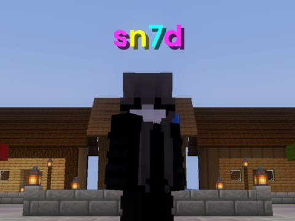

Up to 48 characters of your own text (Ctrl+V works):

- **Orbit**: wraps around the ring like a glowing band. The far side fades out so it always reads cleanly.
- **Engraved**: lies flat on the ground along the ring.
- **Banner**: floats above your head, facing you.

Size, spacing, speed and placement are all adjustable. You can use a smooth modern font or the classic Minecraft one, and colour the text with any colour effect, applied letter by letter.

## Emblems & your own images

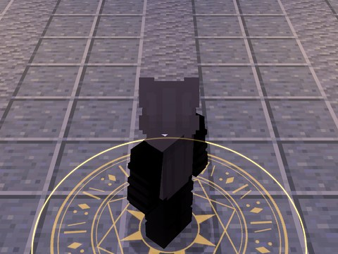 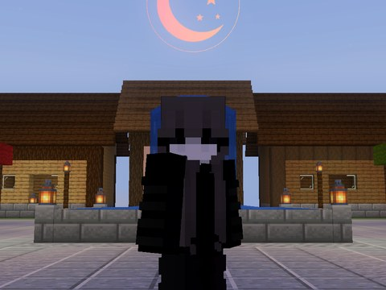 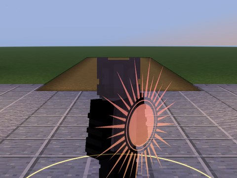

- **Built-in emblems**: *Sigil, Sunburst, Compass, Lotus, Snowflake, Crescent*. They are drawn in white so the colour studio can tint them any colour or effect.
- **Your own images**: drop any `.png` into `config/angelichalo/images/` and it shows up in the Emblem tab within seconds, no restart. Transparent PNGs look best.
- **Placement**: on the **floor**, **above your head** (facing you) or **on your back** (turns with your body).
- Adjustable size, spin and height, with an optional gentle pulse.

## Glow

One switch adds a soft bloom of light around **everything**: the ring, the trail, your text, your emblem and the particles. Turn the overall strength up or down, or make one layer glow more than the others. Every preset except *Classic* turns it on.

## Extras

| Extra | |
|---|---|
| **Embers** | Tiny glowing motes that rise off the ring, twinkle and fade. |
| **Helix** | Small orbs spiralling around you with comet tails. |
| **Jump rings** | A ring bursts across the ground where you jump or land. |
| **Speed reactive** | The ring widens and brightens as you move faster. |
| **Damage flash** *(off by default)* | A flash and shockwave when you take damage, in any colour. |

## Presets

<table>
<tr>
<td align="center"><br><b>Classic</b></td>
<td align="center"><br><b>Classic Scan</b></td>
<td align="center"><br><b>Angelic</b></td>
<td align="center"><br><b>Seraph</b></td>
</tr>
<tr>
<td align="center"><br><b>Scanner</b></td>
<td align="center"><br><b>Inferno</b></td>
<td align="center"><br><b>Frost</b></td>
<td align="center"><br><b>Void</b></td>
</tr>
<tr>
<td align="center"><br><b>Toxic</b></td>
<td align="center"><br><b>Sakura</b></td>
<td align="center"><br><b>Aurora</b></td>
<td align="center"><br><b>Rainbow Scan</b></td>
</tr>
<tr>
<td align="center"><br><b>Radar</b></td>
<td align="center"><br><b>Storm</b></td>
<td align="center"><br><b>Galaxy</b></td>
<td></td>
</tr>
</table>

Presets replace the look and keep your visibility settings.

## Sharing & saved looks

The **Share** tab:

- **Copy my code / Paste a code**: your whole look as one line of text (`AH1:…`), ready to send in chat or Discord.
- **Saved looks**: name it and save it. Saved looks live in `config/angelichalo/presets/*.json`; load or delete them from the list, and share the files directly if you like.

## Compatibility

Every push also runs the full in-game test inside a **typical Skyblock setup** downloaded fresh from Modrinth. The last run passed with:

| Mod | Version |
|---|---|
| Sodium | 0.9.2 |
| Iris | 1.11.4 |
| Lithium | 0.25.3 |
| ImmediatelyFast | 1.16.5 |
| EntityCulling | 1.11.3 |
| FerriteCore | 9.0.0 |
| Skyblocker | 6.11.0 |
| Mod Menu | 20.0.3 |
| Zoomify | 2.17.0 |

Firmament had no 26.2 build at the time, so it wasn't tested. The list lives in `scripts/compat_mods.py`. It also accepts your own list (`--list mods.txt` with slugs, jar file names or `sha1:` hashes), so you can test your exact mod folder.

## Shaders

Iris only draws render pipelines it knows about, so many mods' custom effects vanish when a shaderpack is on. Angelic Halo registers its pipelines through **Iris's public API** (`IrisApi.assignPipeline`), so the halo keeps rendering with shaders. While a pack is active:

- the pack's own bloom takes over (stacking both washes colours to white). You can force the halo's glow back on with *Glow → Bloom With Shaders*;
- soft feathered edges are skipped, because packs dither them into jagged teeth;
- a **shader colour boost** restores saturation that some packs grade away.

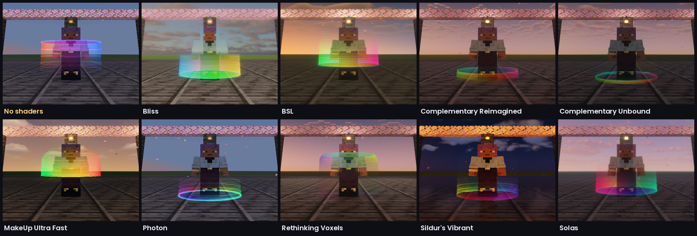

Every push runs the same five scenes without and with each pack (Iris 1.11.4 + Sodium):

| Shaderpack | Version | Result |
|---|---|---|
| Complementary Reimagined | r5.9.3 | ✅ |
| Complementary Unbound | r5.9.3 | ✅ |
| BSL | 10.1.8 | ✅ |
| Photon | v1.4 | ✅ |
| Solas | 3.8 | ✅ |
| Bliss | 2.1.2 | ✅ |
| MakeUp Ultra Fast | 9.6 | ✅ |
| Sildur's Vibrant | 2.02 | ✅ |
| Rethinking Voxels | r0.1-beta9 | ✅ |

## Server safety

Built to be safe on servers like Hypixel:

- **Client-only.** It declares `"environment": "client"` and does nothing on a server.
- **No networking.** It registers no packets or channels and never sends chat or commands. `/angelichalo` is a local Fabric client command.
- **No game changes.** No mixins at all. It only adds draw calls through Fabric's public rendering and screen events, and reads your own position, ground state and health bar for the reactive extras.
- **Read-only.** It never touches blocks, entities, inventory, movement or the camera.

It's a cosmetic, like a resource pack, that only you can see. As always, the server's own rules have the final word.

## How it's drawn

- Geometry is rebuilt every frame in camera-relative space and submitted through Fabric's `LevelRenderEvents.COLLECT_SUBMITS` as custom geometry.
- Lines are **camera-facing ribbons**. Each vertex is pushed sideways by `width × distance × 2 / (projection.m11 × 1080)`, so 2 px stays 2 px at any distance or FOV. A one-pixel feather on each edge anti-aliases them.
- Six small pipelines (registered with Iris for shader support) derive from vanilla's position-colour debug pipeline: translucent and additive bloom, each normal, *always on top*, or *hidden-only* (reverse-Z `LESS_THAN`). That gives "through blocks" with an adjustable opacity for the hidden parts. Vanilla shaders only, so it works on both the **OpenGL and Vulkan** backends.
- Text is submitted with `submitText`; emblems use the vanilla text render type with full-bright light.
- The menu's projector reuses the same geometry builder, projects it through its own orbit camera and depth-sorts every quad (halo, floor grid and mannequin) into one GUI element.
- Animation runs on real time, so it stays smooth when the game is paused or lagging.

## Building from source

Requires JDK 25.

```bash
./gradlew build                 # jar -> build/libs/, also runs the unit tests
./gradlew runClient             # development client
./gradlew runClientGameTest     # boots a real client, renders every preset, style, feature and menu tab, saves screenshots
```

Every push runs CI: build, unit tests (every style × motion × colour combination must produce finite geometry), then an in-game test in a throwaway **singleplayer** world (never a server) that captures the screenshots in this README.

## Credits

- [Poppins](https://github.com/itfoundry/Poppins) by Indian Type Foundry, SIL Open Font License 1.1 (`licenses/Poppins-OFL.txt` inside the jar).
- Built-in emblems are generated by `scripts/make_emblems.py` and ship under this project's MIT license.

<sub>Not affiliated with Mojang, Microsoft or Hypixel. Minecraft is a trademark of Mojang AB.</sub>
